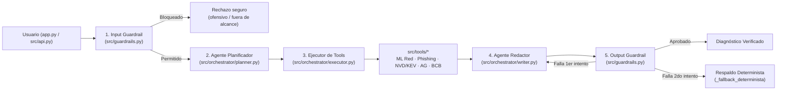

# 🛡️ Sistema Multi-Agente de Ciberseguridad Preventiva 24/7 — La Paz (Bolivia)

Sistema inteligente híbrido de diagnóstico preventivo y priorización de mitigaciones en ciberseguridad diseñado para **Centros Comunitarios, Unidades Educativas y MYPES de la ciudad y el departamento de La Paz** (La Paz, El Alto y Viacha).

Combina un orquestador multi-agente **multi-proveedor** (DeepSeek, OpenAI/GPT, Google Gemini, Anthropic/Claude, OpenCode, OpenRouter, Groq, Ollama o cualquier endpoint OpenAI-compatible) con modelos de **Machine Learning supervisado** (`Random Forest`), inteligencia de amenazas verificada (**NIST NVD v2.0, FIRST EPSS, CISA KEV y URLhaus**), contexto local boliviano (**CGII/AGETIC, ATT, ASFI, INE-MYPES y Tipo de Cambio Oficial del BCB en vivo**), optimización combinatoria mediante **Algoritmo Genético** y **Guardrails deterministas** anti-alucinación.

---

## ✨ Capacidades Principales

- **Orquestación Multi-Agente agnóstica de modelo (`src/agent.py` + `src/llm_provider.py`):**
  - Soporta **DeepSeek**, **OpenAI (GPT / o-series)**, **Google Gemini**, **Anthropic (Claude)**, **OpenCode (Zen / Console)**, **OpenRouter**, **Groq**, **Ollama local** y cualquier API **OpenAI-compatible**.
  - Detección automática por `.env` (`LLM_PROVIDER=auto`) o selección en caliente desde Streamlit y la API REST.
- **Machine Learning supervisado sobre datasets reales (`src/tools.py`):**
  - **Tráfico de red (`UNSW-NB15`)**: clasificación de flujos anómalos.
  - **Phishing y *Quishing* QR (`PhiUSIIL` + `URLhaus` + heurística Bolivia)**: detecta URLs maliciosas y suplantaciones de entidades bolivianas (ASFI, Banco Unión, BCB, AGETIC, Impuestos, Entel, Tigo, pagos QR falsos, etc.).
- **Contexto Boliviano y Tipo de Cambio Oficial BCB en vivo:**
  - Consulta en tiempo real el **Tipo de Cambio Oficial (TCO)** diario del Banco Central de Bolivia mediante APIs públicas (con respaldo local configurable), expresando presupuestos y costos de remediación tanto en **USD** como en **Bolivianos (`Bs`)**.
  - Integra estadísticas sectoriales de MYPES de La Paz ([`data/INE-MYPES_DEPTO.xls`](data/INE-MYPES_DEPTO.xls)) y canales oficiales de reporte (**CGII/AGETIC CSIRT, ATT y ASFI**).
- **Optimización con Algoritmo Genético:** selecciona el subconjunto óptimo de controles y parches maximizando la reducción de riesgo (`CVSS × EPSS` + bonos CISA KEV / AGETIC CSIRT) sin exceder el presupuesto (`USD` / `Bs`) ni las horas técnicas disponibles.
- **Guardrails deterministas + Evals:** bloquea solicitudes ofensivas o fuera de alcance, exige trazabilidad literal de CVEs y cifras contra la salida de herramientas y declara explícitamente la ausencia de estadísticas barriales no disponibles.

---

## 📁 Estructura del Proyecto

```text
Proy-IA/
├── app.py                     # Interfaz web en Streamlit (selector multi-proveedor, TCO en vivo y diagnóstico)
├── requirements.txt           # Dependencias de Python
├── .env.example               # Plantilla de variables de entorno multi-proveedor y TCO BCB
├── .gitignore                 # Exclusiones para Git (secretos, .venv, modelos y CSVs pesados)
├── data/
│   ├── contexto_bolivia_lapaz.json        # Canales oficiales (CGII/AGETIC, ATT, ASFI) y reglas anti-suplantación
│   ├── cve_cache.json                     # Caché verificada de CVEs reales (NVD + EPSS + KEV)
│   ├── INE-MYPES_DEPTO.xls                # Estadísticas de MYPES manufactureras en La Paz (INE/SIIP)
│   ├── known_exploited_vulnerabilities.csv # Catálogo CISA KEV
│   └── perfiles_lapaz.json                # 14 perfiles operativos (La Paz, El Alto y Viacha)
├── datasets/
│   └── NUSW-NB15_features.csv             # Definición de columnas UNSW-NB15
├── models/
│   ├── ml_metrics.json                    # Métricas del modelo de tráfico de red (UNSW-NB15)
│   └── phishing_metrics.json              # Métricas del modelo de phishing en URLs (PhiUSIIL)
├── src/
│   ├── llm/                               # Adaptador universal multi-proveedor LLM
│   │   ├── catalog.py                     # Catálogo de proveedores, modelos sugeridos y LLMConfig
│   │   ├── resolver.py                    # Detección automática e inferencia de credenciales (.env / runtime)
│   │   └── clients.py                     # Clientes nativos Gemini, Anthropic y OpenAI-compatible
│   ├── orchestrator/                      # Orquestación Multi-Agente (Plan-and-Execute + Verificación)
│   │   ├── planner.py                     # Agente Planificador y carga de perfiles (perfiles_lapaz.json)
│   │   ├── executor.py                    # Ejecutor determinista de tools y compactación de evidencia
│   │   ├── writer.py                      # Agente Redactor Técnico y respaldo determinista
│   │   └── pipeline.py                    # Flujo principal ejecutar_diagnostico() con Guardrails
│   ├── tools/                             # Herramientas puras de IA y contexto regional
│   │   ├── bolivia_context.py             # INE-MYPES La Paz, canales CGII/AGETIC/ATT/ASFI y TCO BCB en vivo
│   │   ├── ml_network.py                  # Clasificador de tráfico de red (Random Forest / UNSW-NB15)
│   │   ├── ml_phishing.py                 # Detector de phishing/quishing (PhiUSIIL + URLhaus + Bolivia)
│   │   ├── vuln_intel.py                  # Consulta verificada de CVEs (NVD, EPSS, CISA KEV, AGETIC)
│   │   └── genetic_optimizer.py           # Algoritmo Genético binario con reparación bajo presupuesto/horas
│   ├── data_builders/                     # Constructores reproducibles de datos
│   │   ├── cve_builder.py                 # Descarga y caché de CVEs desde NIST NVD v2.0 + FIRST EPSS
│   │   └── profiles_data.py               # Generación de los 14 perfiles operativos de La Paz
│   ├── agent.py                           # Fachada del orquestador (re-exporta ejecutar_diagnostico)
│   ├── llm_provider.py                    # Fachada del adaptador LLM (re-exporta resolve_llm_config / chat_completion)
│   ├── build_data.py                      # CLI para regenerar cve_cache.json y perfiles_lapaz.json
│   ├── api.py                             # API REST FastAPI (/health, /tipo-cambio, /proveedores-llm, /diagnosticar)
│   ├── guardrails.py                      # Guardrails deterministas de entrada y salida
│   ├── train_ml.py                        # Entrenamiento del clasificador de tráfico (UNSW-NB15)
│   ├── train_phishing.py                  # Entrenamiento del clasificador de phishing (PhiUSIIL)
│   ├── test_deepseek.py                   # Verificación rápida por CLI de cualquier proveedor LLM configurado
│   └── extraer_alertas_agetic.py          # Script opcional (Playwright) para alertas de csirt.gob.bo
└── evals/
    ├── eval_dataset.json                  # 15 casos de evaluación end-to-end
    ├── eval_results.json                  # Últimos resultados de evaluación
    ├── run_evals.py                       # Runner de evaluación automática
    ├── test_guardrails.py                 # Tests unitarios de guardrails
    ├── test_llm_provider.py               # Tests unitarios del adaptador multi-proveedor LLM
    └── test_tools.py                      # Tests unitarios de AG, Phishing/Quishing Bolivia y API BCB
```

---

## 🧠 Cómo Funciona el Codebase (Guía Técnica)

El sistema separa estrictamente la **coordinación lingüística** (LLM) del **cálculo numérico y clasificación** (Machine Learning, Algoritmo Genético y reglas deterministas), garantizando que ninguna cifra o CVE sea inventada.

### 1. Flujo de Ejecución (`ejecutar_diagnostico`)



Paso a paso dentro de [`src/orchestrator/pipeline.py`](src/orchestrator/pipeline.py):
1. **Guardrail de Entrada (`validar_entrada` en `src/guardrails.py`):** Inspecciona la consulta antes de llamar a cualquier LLM. Bloquea solicitudes ofensivas (exploits, fuerza bruta, DDoS) o ajenas a ciberseguridad, y detecta si el usuario pide estadísticas barriales de La Paz para activar la regla de transparencia.
2. **Resolución de LLM (`resolve_llm_config` en `src/llm/resolver.py`):** Detecta automáticamente el proveedor configurado en `.env` o en la petición (`DeepSeek`, `OpenAI`, `Gemini`, `Anthropic`, `OpenCode`, `OpenRouter`, `Groq`, `Ollama` o endpoint custom) sin acoplar la lógica del agente a una sola API.
3. **Agente Planificador (`_agente_planificador` en `src/orchestrator/planner.py`):** Combina la consulta con el perfil seleccionado de `data/perfiles_lapaz.json`, extrae presupuestos expresados en Bolivianos (`Bs`) convirtiéndolos a `USD` con el TCO BCB vigente, y genera un plan JSON con las tecnologías y herramientas a ejecutar.
4. **Ejecutor de Tools (`_ejecutor_tools` en `src/orchestrator/executor.py`):** Invoca de forma determinista las herramientas de `src/tools/`:
   - `ml_network.py`: Clasifica flujos de red (`ataque` / `normal`) usando el `RandomForestClassifier` entrenado sobre `UNSW-NB15`.
   - `ml_phishing.py`: Evalúa URLs combinando `URLhaus`, el modelo `RandomForestClassifier` entrenado sobre `PhiUSIIL` y reglas heurísticas de suplantación a entidades bolivianas (`ASFI`, `Banco Unión`, `BCB`, `AGETIC`, `Impuestos`, `Entel`, `Tigo`, pagos `QR`).
   - `vuln_intel.py`: Consulta `data/cve_cache.json` cruzando con `CISA KEV` (`known_exploited_vulnerabilities.csv`) y alertas de `AGETIC CSIRT`, ponderando cada riesgo por `CVSS × EPSS × bonos`.
   - `genetic_optimizer.py`: Ejecuta un **Algoritmo Genético binario** (población=60, generaciones=80, torneo, cruce, mutación adaptativa y reparación factible `_repair_chromosome`) para elegir el subconjunto de parches que maximiza la reducción de riesgo sin superar el presupuesto (`USD`/`Bs`) ni las horas técnicas disponibles.
   - `bolivia_context.py`: Adjunta canales oficiales de reporte (`CGII/AGETIC`, `ATT`, `ASFI`), el TCO oficial del BCB en vivo y estadísticas departamentales de `INE-MYPES_DEPTO.xls`.
5. **Agente Redactor y Guardrail de Salida (`src/orchestrator/writer.py` + `validar_salida`):** Resume el registro de herramientas (`_compactar_registro_para_llm`) y redacta el informe técnico. Luego `validar_salida` verifica literalmente que todo `CVE-XXXX-XXXX` y cifra citada exista en la salida de las tools; si detecta una alucinación, reintenta 1 vez con feedback y, si persiste, entrega `_fallback_determinista` (100% libre de alucinaciones).

### 2. Puntos de Entrada del Proyecto
- **Interfaz Web (`app.py`):** Aplicación Streamlit para pruebas interactivas, selección de los 14 perfiles de La Paz, ajuste de TCO BCB y cambio en caliente de proveedor/modelo LLM.
- **API REST (`src/api.py`):** Servicio FastAPI que expone `ejecutar_diagnostico` vía HTTP (`/diagnosticar`, `/tipo-cambio`, `/proveedores-llm`, `/health`).
- **Construcción y Entrenamiento (`src/build_data.py`, `src/train_ml.py`, `src/train_phishing.py`):** Scripts reproducibles para regenerar `cve_cache.json`, `perfiles_lapaz.json` y los pipelines `.joblib`.
- **Evaluación (`evals/run_evals.py` y `pytest`):** Verifica unitariamente guardrails, adaptadores LLM, Algoritmo Genético, API BCB y corre los 15 escenarios end-to-end.

---

## ⚙️ Requisitos Previos

- **Python 3.10+** (probado en Python 3.11 – 3.14)
- **Git**
- Al menos una **API Key** de cualquiera de los proveedores soportados (DeepSeek, OpenAI/GPT, Google Gemini, Anthropic/Claude, OpenCode, OpenRouter, Groq) o **Ollama** ejecutándose localmente.

---

## 🚀 Instalación Paso a Paso

### 1. Clonar el repositorio

```bash
git clone https://github.com/HzuDev/Proy-IA.git
cd Proy-IA
```

### 2. Crear y activar el entorno virtual

En **Linux / macOS**:
```bash
python3 -m venv .venv
source .venv/bin/activate
```

En **Windows (PowerShell)**:
```powershell
python -m venv .venv
.venv\Scripts\Activate.ps1
```

### 3. Instalar dependencias

```bash
pip install --upgrade pip
pip install -r requirements.txt
```

### 4. Configurar variables de entorno (`.env`)

Copia el archivo de ejemplo:
```bash
cp .env.example .env
```

Configura **la clave del proveedor que prefieras** en `.env` (con `LLM_PROVIDER=auto` el sistema detecta automáticamente cuál estás usando):

```env
LLM_PROVIDER=auto

# Elige uno o varios según tu preferencia:
DEEPSEEK_API_KEY=sk-tu-api-key-de-deepseek
# OPENAI_API_KEY=sk-proj-...
# GEMINI_API_KEY=AIza...
# ANTHROPIC_API_KEY=sk-ant-...
# OPENCODE_API_KEY=...

# Respaldo local del Tipo de Cambio Oficial BCB si no hay conexión a las APIs públicas
TIPO_CAMBIO_BOB=11.83
```

Verifica la conexión desde terminal (funciona con tu configuración en `.env` o pasando `--provider` y `--model`):
```bash
python -m src.test_deepseek
# Ejemplo con otro proveedor/modelo:
python -m src.test_deepseek --provider gemini --model gemini-2.5-flash
```

---

## 📊 Datos y Modelos de Machine Learning

Por tamaño, los **datasets crudos** y los **modelos `.joblib` entrenados** se excluyen en `.gitignore`.

### Archivos ya incluidos en Git
- `data/cve_cache.json` y `data/perfiles_lapaz.json` (regenerables con `python -m src.build_data`).
- `data/contexto_bolivia_lapaz.json` y `data/INE-MYPES_DEPTO.xls`.
- `data/known_exploited_vulnerabilities.csv` (catálogo CISA KEV).

### Cómo entrenar los modelos `.joblib` localmente

1. **Detección de intrusiones (`models/modelo_red_unsw.joblib`)**:
   - Descarga `UNSW_NB15_training-set.csv` y `UNSW_NB15_testing-set.csv` desde la [página oficial de UNSW-NB15](https://research.unsw.edu.au/projects/unsw-nb15-dataset) (o desde su [carpeta oficial en CloudStor](https://cloudstor.aarnet.edu.au/plus/index.php/s/2DhnLGDdEECo4ys?path=%2FUNSW-NB15%20-%20CSV%20Files%2Fa%20part%20of%20training%20and%20testing%20set)) y colócalos en `data/`.
   - Ejecuta:
     ```bash
     python -m src.train_ml
     ```

2. **Detección de phishing en URLs (`models/modelo_phishing_url.joblib`)**:
   - Descarga el dataset desde [UCI Machine Learning Repository — PhiUSIIL Phishing URL](https://archive.ics.uci.edu/dataset/967/phiusiil+phishing+url+dataset), descomprímelo y coloca `PhiUSIIL_Phishing_URL_Dataset.csv` en `data/`.
   - Ejecuta:
     ```bash
     python -m src.train_phishing
     ```

3. **Feed reciente de URLhaus (`data/urlhaus_recent.csv`)**:
   - Descarga el CSV reciente desde [urlhaus.abuse.ch/downloads/csv_recent/](https://urlhaus.abuse.ch/downloads/csv_recent/) y guárdalo en `data/urlhaus_recent.csv`.

---

## ▶️ Cómo Ejecutar el Proyecto

### Opción A: Interfaz Web (Streamlit)

```bash
streamlit run app.py
```

Disponible en `http://localhost:8501`. Desde la barra lateral puedes:
- Elegir el **Proveedor de IA y Modelo** (o pegar otra API Key sin tocar `.env`).
- Visualizar y ajustar el **Tipo de Cambio Oficial del BCB (`Bs / USD`)**.
- Seleccionar cualquiera de los **14 perfiles de La Paz, El Alto y Viacha**.

### Opción B: API REST (FastAPI + Uvicorn)

```bash
uvicorn src.api:app --host 0.0.0.0 --port 8000 --reload
```

Endpoints disponibles:
- `GET http://localhost:8000/health` — estado del servicio.
- `GET http://localhost:8000/tipo-cambio` — Tipo de Cambio Oficial (TCO) diario del BCB en vivo.
- `GET http://localhost:8000/proveedores-llm` — lista de proveedores soportados y estado de configuración.
- `GET http://localhost:8000/docs` — documentación interactiva (Swagger UI).
- `POST http://localhost:8000/diagnosticar` — ejecuta el pipeline multi-agente.

Ejemplo con `curl`:
```bash
curl -X POST http://localhost:8000/diagnosticar \
  -H "Content-Type: application/json" \
  -d '{
    "query": "Diagnostica vulnerabilidades para router Wi-Fi y WordPress con Bs 450 y 4 horas.",
    "perfil_id": "LPZ-MY-01",
    "url_sospechosa": "https://asfi-renta.com/pago-qr",
    "llm_provider": "auto"
  }'
```

---

## 🧪 Pruebas y Evaluaciones

### Tests unitarios (`pytest`)

```bash
python -m pytest -v
```

*(Nota: si aún no entrenaste `modelo_phishing_url.joblib`, puedes correr `python -m pytest evals/test_guardrails.py evals/test_llm_provider.py -v`.)*

### Suite de evaluación end-to-end (15 escenarios)

```bash
python evals/run_evals.py
```

Genera el resumen de fidelidad, bloqueos de guardrail, reducción promedio de riesgo del Algoritmo Genético y latencia en `evals/eval_results.json`.

---

## 📝 Notas Adicionales

- **Script opcional de AGETIC (`src/extraer_alertas_agetic.py`)**: usa `playwright` (no incluido en `requirements.txt` por ser opcional) para extraer alertas desde `csirt.gob.bo`:
  ```bash
  pip install playwright
  playwright install chromium
  python -m src.extraer_alertas_agetic
  ```
- **Seguridad**: nunca subas el archivo `.env` con tus API keys reales al repositorio.
